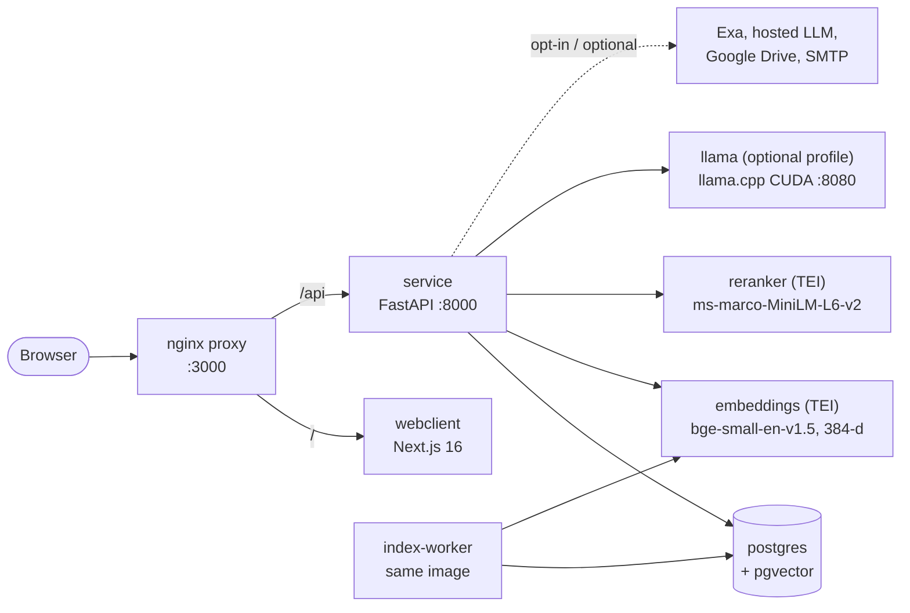

# Architecture overview

PEKA is a three-tier stack: a Next.js UI, a FastAPI service with a sibling index worker, and supporting infrastructure (Postgres/pgvector, TEI embeddings, optional llama.cpp, nginx).

## Component diagram



Solid lines stay on the machine. Dotted lines are optional services outside it; each is off unless configured. More diagrams (ER, sequences, deployment) are in [Design](../project/design.md).

## Responsibilities

| Component | Role |
|-----------|------|
| **webclient** | Auth UI, chat (SSE), knowledge library with Google Drive import, account settings, admin users, audit events and provider settings |
| **service** | REST + SSE API: auth, files, Google Drive import, search, chat, audit log, admin provider settings |
| **index-worker** | Polls `index_jobs`, chunks original text, embeds, activates chunk sets |
| **postgres** | Users, invitations, files, jobs, chunk sets, chunks (vector), conversations, messages, audit events, Google Drive connections, provider settings |
| **embeddings** | Hugging Face Text Embeddings Inference (OpenAI-compatible `/v1/embeddings`) |
| **reranker** | Hugging Face Text Embeddings Inference with a cross-encoder; scores the top 20 search candidates on the CPU |
| **llama** (optional) | Local OpenAI-compatible chat completions for chat |
| **nginx** | Single entry: UI + `/api` strip-proxy; long timeouts for streams |

## Backend layering

Feature modules under `service/app/<feature>/` follow:

```text
routes → service → repository
```

- **Routes**: FastAPI routers, auth deps, status codes
- **Schemas**: Pydantic request/response models
- **Services**: Business logic, RAG/LLM orchestration
- **Repositories**: SQL via `psycopg` (`dict_row`)
- **Models**: SQLAlchemy declarative models primarily for Alembic metadata

Routers are registered explicitly in `service/app/__init__.py` and mounted from `app.main:app`.

## Frontend layering

```text
app/ (thin pages)
  → _partials/ (route-local UI)
  → components/ (shared Theme + ui)
  → services/ (React Query + axios / fetch)
  → utils/ (auth storage, HTTP client)
  → interface/ (TS types)
```

Workspace routes are gated by Next.js 16 `proxy.ts` (cookie presence) and further by client-side `/auth/me` and role checks.

## External integrations

| Integration | Config | Use |
|-------------|--------|-----|
| OpenAI-compatible LLM | `LLM_*` env + optional DB overrides | Chat answers, retrieval planning |
| TEI embeddings | `EMBEDDING_*` | Query and chunk vectors |
| Exa | `EXA_*` (optional) | Web search when user enables it |
| TEI reranker | `RERANK_*` | Rescores search candidates |
| Google Drive API | `GOOGLE_*`, `APP_BASE_URL` (optional) | One-off import of files a user picks |
| SMTP server | `SMTP_*` (optional) | Invitation emails; without it the admin copies the invite link |

Admin can override LLM/Exa URL, key, and model at runtime via `/admin/settings/providers` (stored in `provider_settings`). Embedding settings remain environment-only.

## What is not in the stack

- No Redis/Celery — indexing uses a Postgres job table and a single polling worker
- No FastAPI CORS middleware in code (browser hits same origin via nginx `/api` in Compose)
- No message broker for chat history — conversations live in Postgres

## Related docs

- [Key flows](flows.md)
- [Service](../service/README.md)
- [Web client](../webclient/README.md)
- [Config](../config/README.md)
