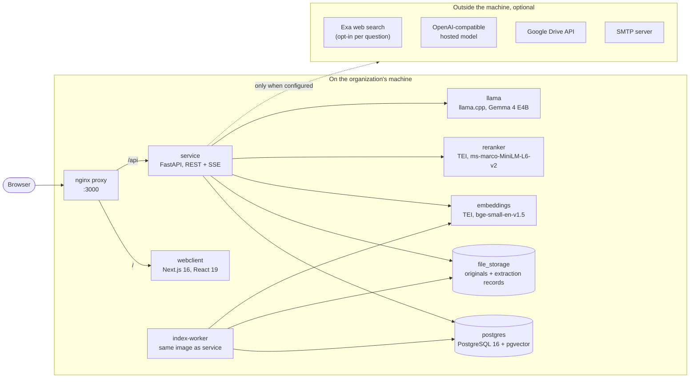
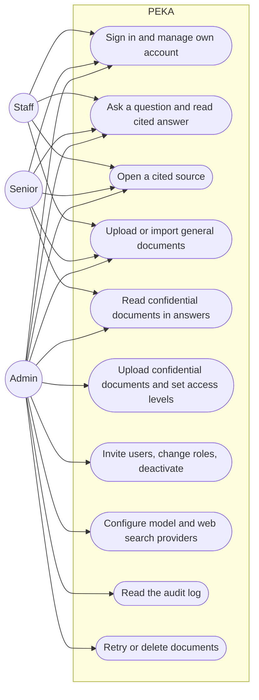
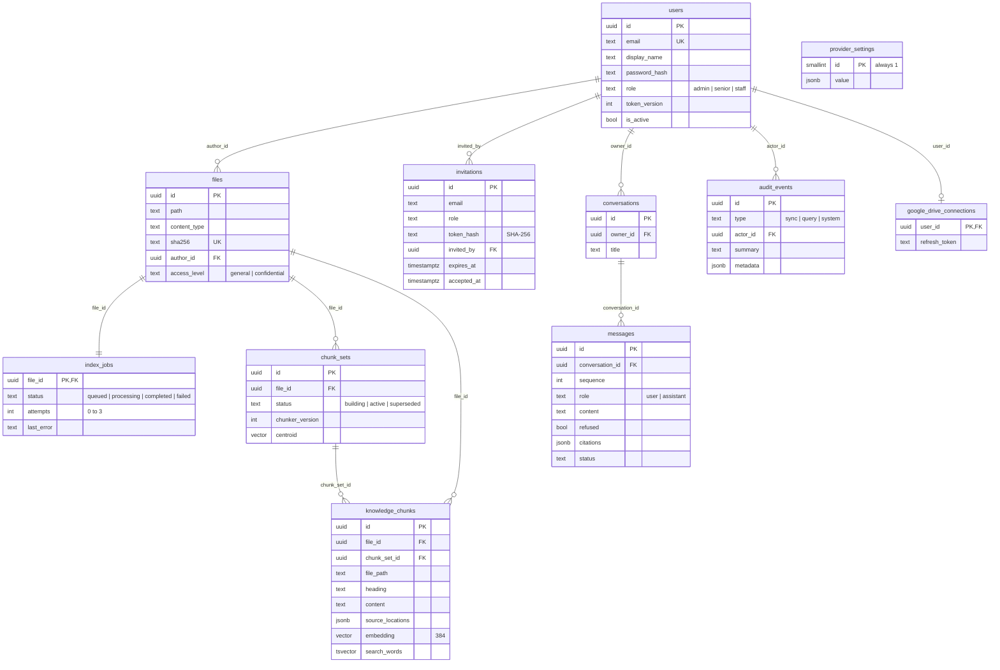
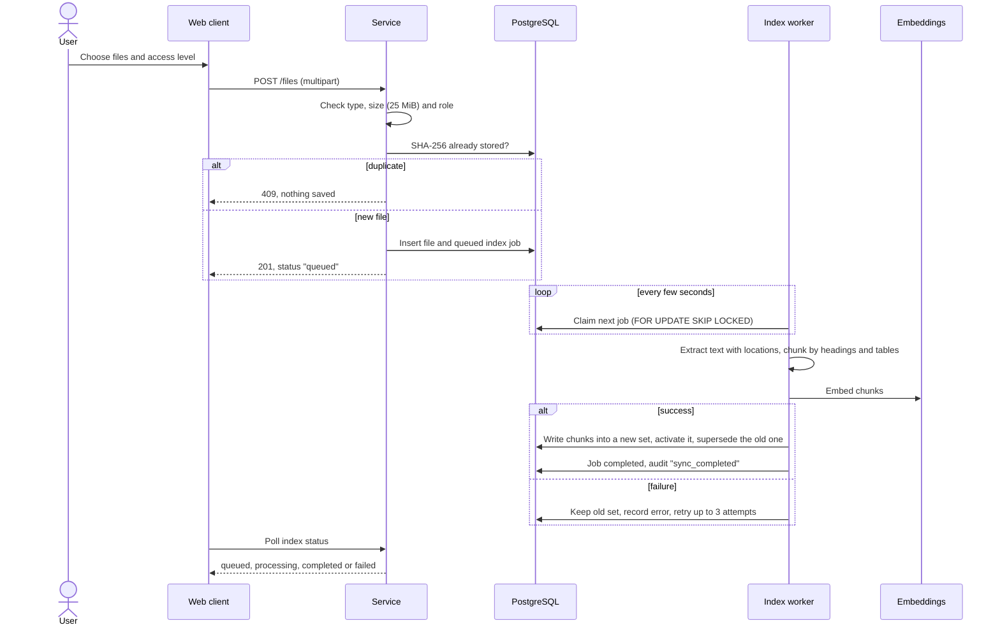
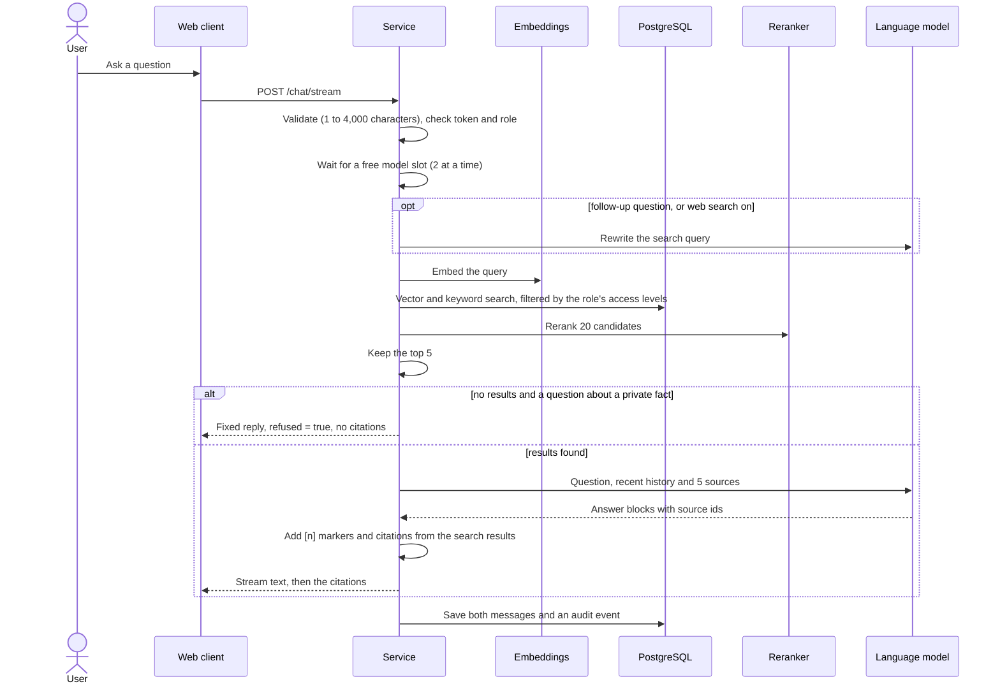
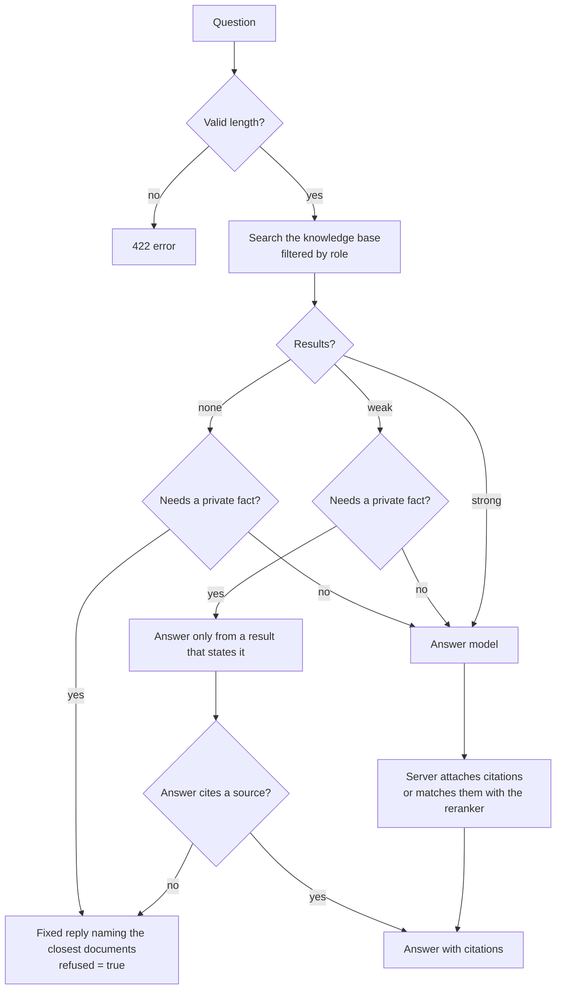
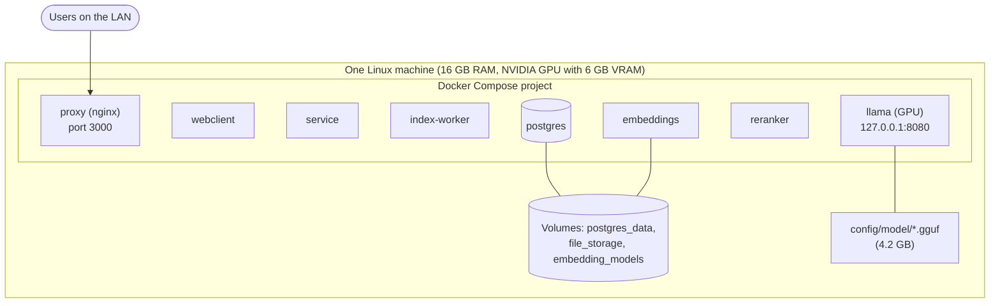

# Design

The architecture, data model and main flows of PEKA as built, drawn as Mermaid diagrams (GitHub renders them). Each diagram matches the code on `main` at commit `4a08cd9`. Deeper explanations are in [Architecture overview](../architecture/overview.md), [Key flows](../architecture/flows.md), [Indexing](../architecture/indexing.md), [Chat and RAG](../architecture/chat-and-rag.md) and [Data model](../service/data-model.md).

## Why this design

| Decision | Reason | Requirement |
|----------|--------|-------------|
| One PostgreSQL database for operational data and vectors | The role filter runs inside the same SQL statement as the search, so a restricted chunk never leaves the database | FR13, NFR01 |
| A separate index worker polling a job table | Indexing never blocks chat, and no message broker is needed | FR16, NFR04 |
| Versioned chunk sets, switched only when a job succeeds | A failed re-index leaves the previous index in use | FR16 |
| Embeddings, reranker and language model as local containers | No document text leaves the machine in local mode | NFR03, Objective 2 |
| Citations built by the server from search results | The model cannot invent a source | FR08, Objective 4 |
| Two model slots and a queue | The 6 GB GPU's shared context does not overflow | FR20, NFR04, NFR05 |
| Modular monolith (`routes → service → repository`) | Small team, one deployable service, clear layers | Maintainability |

## Components

*Figure: Components. Everything in the upper box runs on one machine; the services below are used only when configured.*

| Component | Responsibility |
|-----------|----------------|
| nginx proxy | Single entry point; `/` to the web client, `/api/` to the service; long timeouts for streamed answers |
| webclient | Sign-in, invitations, chat, knowledge library, account settings, admin users, audit log and provider settings |
| service | Authentication and roles, files, Google Drive import, search, chat, audit log, provider settings |
| index-worker | Claims indexing jobs, extracts text, chunks, embeds and activates a new chunk set |
| postgres | Users, invitations, files, jobs, chunk sets, chunks with 384-dimension vectors, conversations, messages, audit events, settings |
| embeddings | Turns chunks and questions into vectors |
| reranker | Scores the 20 best candidates against the question |
| llama | Generates answers; optional because any OpenAI-compatible endpoint can replace it |

## Use cases

*Figure: Use cases by role. Staff and senior users can also retry or delete documents they uploaded.*

## Data model

*Figure: Entity-relationship diagram (11 tables, migrations 002 to 024). Timestamps are left out.*

Constraints that carry business rules:

| Constraint | Rule |
|------------|------|
| `users.role` `CHECK` | Only `admin`, `senior` or `staff` |
| `files.access_level` `CHECK` | Only `general` or `confidential` |
| `files.sha256` unique | The same content cannot be uploaded twice (FR14) |
| `index_jobs.file_id` primary key | One indexing job per file |
| `chunk_sets.status` `CHECK` | `building`, `active` or `superseded`; only active sets are searched |
| `provider_settings.id = 1` | A single settings row |
| `ON DELETE CASCADE` from files, users and conversations | Deleting a file removes its job, sets and chunks; deleting a conversation removes its messages |
| Trigger from migration 024 | A superseded chunk kept for an old citation is deleted with the last message citing it |

The full column list and every migration are in [Data model](../service/data-model.md).

## Upload and indexing

*Figure: Upload and indexing sequence.*

## Chat sequence

*Figure: Chat sequence. Details and the weak-evidence path are in [Chat and RAG](../architecture/chat-and-rag.md).*

## Answer decision flow

*Figure: How PEKA decides to answer or decline. "Weak" means the top rerank score is below `SEARCH_EVIDENCE_FLOOR`.*

## Deployment

*Figure: Deployment on one machine. Only the proxy is reachable from other machines.*

The same Compose file runs in development (`make setup`, `make up`, with hot reload) and production style (`make prod-up`). See [System requirements](../system-requirements.md) and [Config](../config/README.md).

## API

All endpoints are listed in the [API reference](../service/api-reference.md). The main groups:

| Group | Prefix | Used by |
|-------|--------|---------|
| Authentication, users, invitations | `/auth` | All users; user management is admin-only |
| Files | `/files` | All users; confidential uploads and access levels are admin-only |
| Google Drive import | `/integrations/google` | All users |
| Search | `/search` | All users |
| Chat | `/chat` | All users; conversations are owner-only |
| Audit log | `/admin/audit-events` | Admin |
| Provider settings | `/admin/settings/providers` | Admin |
| Health | `/health` | Public |
| Online status and configured features | `/status` | All users |

The web client talks only to the API through nginx; it has no database access. The service talks to the embedding, reranking and language model servers through their OpenAI-compatible or TEI HTTP APIs.
